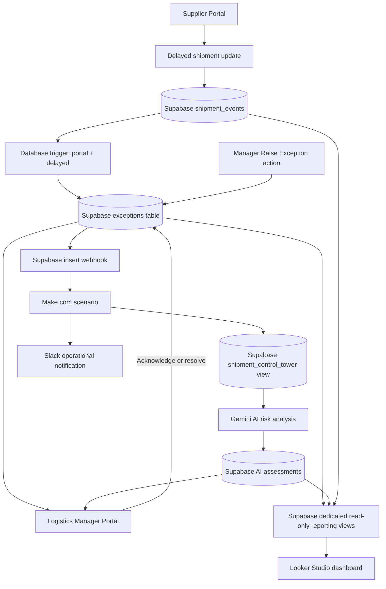

# LogiGuard AI Architecture

This diagram describes the actual implemented workflow and the externally configured reporting and automation components.

## End-to-end operational workflow

## Supplier update flow

A supplier signs in and opens a shipment assigned through that user's Supabase profile. The supplier selects a status, tracking number, revised ETA, and notes.

The supplier update is written to `shipment_events` with:

- The supplier's verified shipment ID.
- The selected shipment status.
- A portal event source.
- Tracking, ETA, and notes incorporated into the event description.

The frontend does not update `shipments` directly and does not call Gemini or Make.com.

When the event status is `delayed`, a database trigger creates a `late_arrival` exception. The trigger checks shipment ownership so an authenticated supplier cannot create an exception for an unrelated shipment. This exception is generated automatically and originates from the supplier's shipment event.

## Manager workflow

The logistics manager or administrator can:

- Review live shipment, supplier, inventory, and exception data.
- Open shipment and exception details.
- Review AI assessment records.
- Acknowledge or resolve a managed exception.
- Raise a shipment exception manually from the Exceptions page.

Manager actions are written to Supabase through the existing authenticated data-access service. Suppliers do not receive manager-only pages or direct exception-insertion access.

The Raise Exception action creates a manual exception through a separate manager-initiated path. It does not use the supplier-delay trigger. Both automated and manual exceptions are inserted into the same exceptions table, which is configured to send INSERT events to the Make.com webhook. The supplier-delay workflow has been successfully tested end-to-end; the manual exception path is an additional application feature.

## AI and notification workflow

The existing exception insert webhook triggers the Make.com scenario when an exception is added. For demonstrations, Make.com is currently run with **Run once** rather than continuous scheduling/processing.

After receiving an exception, Make.com retrieves relevant shipment and inventory context from the Supabase `shipment_control_tower` view. It combines that operational context with the exception details before sending the information to Gemini for risk analysis. The assessment workflow stores Gemini's assessment in Supabase.

Slack receives the operational notification as a separate output of Make.com. The manager portal reads exceptions and stored AI assessments independently from Supabase for review and action.

This repository does not contain the Make.com scenario, Gemini credentials, Slack credentials, or webhook secrets.

## Reporting views

Looker Studio/Data Studio is not used as an application database or operational workflow engine. It consumes dedicated read-only reporting views from Supabase.

The reporting layer should be understood separately from the transactional application:

- Supabase tables hold operational records.
- Row-level security controls application access.
- Dedicated read-only views expose reporting data to Looker Studio.
- Looker Studio/Data Studio presents dashboards for management reporting.

The exact view definitions and Looker Studio configuration are external to this frontend repository and must be verified in the deployed environment.

The reporting views draw from the relevant operational tables, including shipments, shipment items, shipment events, exceptions, AI assessments, inventory levels, products, suppliers, and warehouses.

## Security boundaries

- Manager and supplier routes are selected from authenticated profile roles.
- Supplier shipment access is derived from the supplier ID on the user's profile.
- Supplier event inserts remain subject to existing Supabase RLS policies.
- The database trigger is the server-side mechanism that creates automated exceptions.
- Suppliers should not receive direct insert access to `exceptions`.
- The frontend uses the publishable Supabase configuration only.
- Secret credentials remain outside the browser application.
